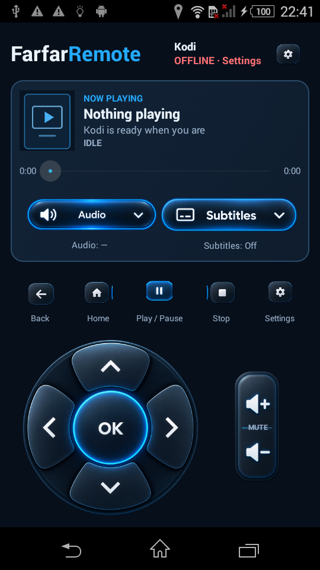
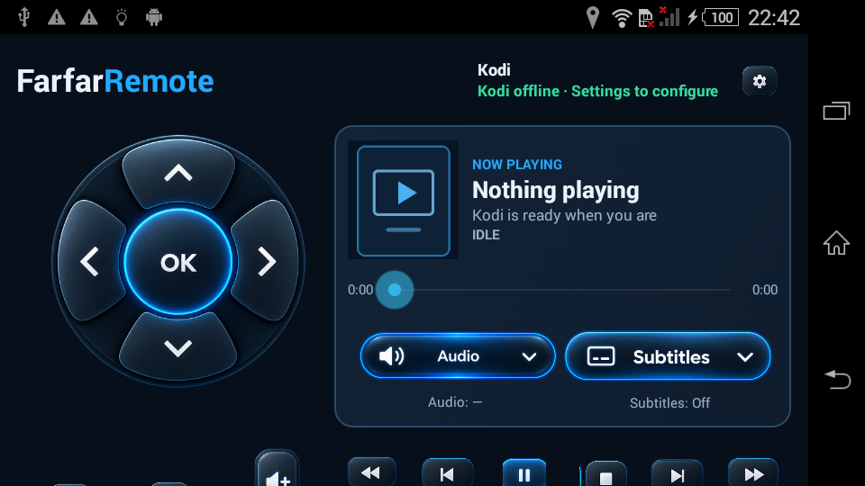
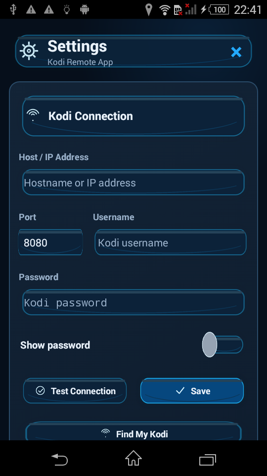

# FarfarRemote

A lightweight Kodi remote for Android, available as a regular app or a dedicated remote-control launcher.

## Choose your edition

### FarfarRemote App — modern mobile track

For everyday Android phones. It installs as a regular app, appears in the app drawer, and never registers as Android HOME. It is the recommended choice for phones used day to day.

- Minimum Android version: Android 4.4 / API 19.
- Target Android version: Android 16 / API 36.
- Newer Android APIs are guarded at runtime so the package can retain its broad install range.

### FarfarRemote OS — legacy dedicated-device track

For old or dedicated Android devices, especially repurposed hardware such as the Sony Xperia E4g E2003. It can be selected as the Android HOME launcher and retains the compatibility settings used by the tested Xperia installation.

- Minimum Android version: Android 4.4 / API 19.
- Target Android version: Android 9 / API 28, intentionally conservative for the legacy HOME-device setup.
- FarfarRemote OS is still an Android application and launcher configuration, not a separate Android ROM. Root, firmware modification, and debloating are not required.

Both editions share the Kodi client, controls, Settings, graphics, and Find My Kodi. They have different application IDs and can be installed side by side:

| Edition | Application ID | Android SDK strategy |
| --- | --- | --- |
| FarfarRemote App | `org.farfarremote.app` | min API 19, target API 36 |
| FarfarRemote OS | `org.farfarremote` | min API 19, target API 28 |

## Screenshots

The screenshots show the App edition on a Sony Xperia E4g E2003 (Android 4.4/API 19), offline. No Kodi connection or media is shown.

**Portrait remote**



**Landscape remote**



**Settings**



## Features

- D-pad and OK, Back, Kodi Home, play/pause, stop, previous/next, rewind/fast-forward, volume and mute.
- Confirmed Power Off control for the Kodi device. It asks Kodi to close and shut down its host; it does not power off the Android remote.
- Kodi Now Playing information, artwork, playback progress, and seek controls.
- Audio and subtitle stream selection on the remote, including subtitle Off when Kodi provides it.
- Local folder favorites: save the currently open Kodi folder with a chosen name and reopen it from the Favorites button beneath the Movies/TV Shows/Music/Add-ons shortcuts.
- Portrait, landscape, and automatic orientation modes.
- Saved Kodi connection settings, optional keep-awake, reconnect, and haptic settings.
- Find My Kodi searches for Kodi's DNS-SD/Zeroconf HTTP JSON-RPC service only when requested. It verifies a selected endpoint and asks before saving it. Discovery does not run in the background.
- Manual host, port, username, and password entry remains available when discovery is unavailable.
- Optional external support link: <https://buymeacoffee.com/farfarspelar>.

The Power Off control sends Kodi's `System.Shutdown` JSON-RPC request after confirmation. Shutdown depends on the operating system and permissions of the device running Kodi. See the [Kodi JSON-RPC System.Shutdown method](https://kodi.wiki/view/JSON-RPC_API/v8#System.Shutdown).

## Android compatibility and security notes

The App track targets API 36 to adopt modern Android behavior and meet the current Google Play target API requirement. Android 15 and later enforce edge-to-edge for apps targeting API 35+, so the App applies system bar, display cutout, and keyboard insets. On Android 13+, App Settings uses the platform Back callback. The OS track remains target API 28 to protect the established Xperia behavior. See Android's [target API requirements](https://developer.android.com/google/play/requirements/target-sdk), [Android 15 behavior changes](https://developer.android.com/about/versions/15/behavior-changes-15), and [Android 16 behavior changes](https://developer.android.com/about/versions/16/behavior-changes-16).

Android 17 / API 37 requires local network permission or a system-mediated picker for apps that access LAN devices. This project currently targets API 36, so it does not request that permission yet. Before a target 37 update, Find My Kodi and direct Kodi connections must be migrated and tested under the new policy. See [local network permission guidance](https://developer.android.com/privacy-and-security/local-network-permission).

Kodi's built-in JSON-RPC connection uses HTTP. FarfarRemote must allow cleartext traffic for Kodi communication and currently uses it for configured connections; HTTP does not encrypt Kodi credentials or commands. Use a trusted local network. The target SDK improves platform behavior but cannot make Kodi's HTTP protocol encrypted.

## Kodi setup and connection

Enable Kodi's web server / HTTP control, then enter the Kodi hostname or IP, port, and any credentials in FarfarRemote Settings. The default port shown by Kodi is commonly 8080, but use the port configured in your Kodi installation.

Find My Kodi additionally needs Kodi Zeroconf service announcements and multicast discovery on the local network. Guest Wi-Fi, client isolation, multicast filtering, and firewalls may prevent discovery. If no device is found, use the visible manual connection fields. A discovered endpoint is tested with JSON-RPC and is not saved until you confirm it.

## Download and install

### Current release candidate: v0.4.4-rc1

- **FarfarRemote App — Android 4.4+ (API 19+)** — [Download the regular Android app](https://github.com/farfarspelar/FarfarRemote-OS/releases/download/v0.4.4-rc1/FarfarRemote-App-Android4.4plus-API19plus-v0.4.4-rc1.apk). For everyday phones, including Android 13 and Android 15. It does not register as the HOME launcher. Minimum: Android 4.4 / API 19; target: API 36.
- **FarfarRemote OS — Android 4.4+ (API 19+)** — [Download the dedicated-device launcher](https://github.com/farfarspelar/FarfarRemote-OS/releases/download/v0.4.4-rc1/FarfarRemote-OS-Android4.4plus-API19plus-v0.4.4-rc1.apk). For older or dedicated devices such as the Xperia E4g E2003. Minimum: Android 4.4 / API 19; target: API 28; includes the HOME launcher intent and preserves the Xperia OS track.

These are prerelease APKs for testing. See the [v0.4.4-rc1 release notes and checksums](https://github.com/farfarspelar/FarfarRemote-OS/releases/tag/v0.4.4-rc1). For other versions, browse the [GitHub Releases page](https://github.com/farfarspelar/FarfarRemote-OS/releases). Choose the APK for the intended use:

- **FarfarRemote App:** install `FarfarRemote-App-Android4.4plus-API19plus-v0.4.4-rc1.apk` as a regular app and open it from the app drawer. Android's Home button continues to open the phone's existing launcher.
- **FarfarRemote OS:** install `FarfarRemote-OS-Android4.4plus-API19plus-v0.4.4-rc1.apk` on a dedicated device. Press Android Home and select FarfarRemote to make it the launcher. For an existing OS installation, update with the OS APK only; do not uninstall the app or clear its data. Updates must use the same signing certificate as the installed build.

Android may ask you to allow APK installation from the browser or file manager. The current RC artifacts are debug-signed. Read [Signing and updates](#signing-and-updates) before distributing updates to an established installation.

## Build from source

Requirements: JDK 17 or newer, Android SDK Platform 36, Android SDK Build Tools 35.0.0, Python 3, and the included Gradle wrapper. Set `ANDROID_HOME` or `ANDROID_SDK_ROOT` to the SDK path.

```sh
python3 tools/test_v03_contract.py
./gradlew testAppDebugUnitTest testOsDebugUnitTest assembleAppDebug assembleOsDebug
./tools/build_distributions.sh
```

Gradle flavors are named `app` and `os`. Both APKs compile against API 36 and require Android 4.4 / API 19 or newer. The App flavor targets API 36 and the OS flavor targets API 28. The script builds, checks package IDs and SDK metadata, and writes the clearly labeled APKs and SHA-256 files under `dist/`.

## Signing and updates

Debug APKs are for testing and the current development update path, not a production signing strategy. Android allows an in-place update only when both the application ID and signing certificate match. Keep a secure backup of the signing key for long-lived installations. Do not change the certificate for existing `org.farfarremote` installs or uninstall them to work around a signature mismatch.

## Graphics provenance

The project owner reports that FarfarRemote's UI graphics and visual references were generated with ChatGPT from prompts written by the owner, who directed the visual design. The generated images were integrated as FarfarRemote UI assets and references. App code and Android XML drawables are project-authored source code under GPL-3.0. No official Kodi or Buy Me a Coffee logo is included; the coffee cup is a generic generated project graphic. See [ASSET_PROVENANCE.md](ASSET_PROVENANCE.md) for the inventory and notes.

## Known limitations

- The legacy OS track is primarily verified on a Sony Xperia E4g E2003 running Android 4.4/API 19.
- The user reports FarfarRemote App runs without problems on a Samsung phone with Android 13. API 33 and API 35 emulator smoke checks also passed for the App track; those checks do not replace testing across other device makers and models.
- Kodi discovery depends on Zeroconf announcements and multicast support; manual connection is the fallback.
- Kodi HTTP JSON-RPC is unencrypted.
- Kodi determines which artwork and media metadata are available.
- The OS edition is not a ROM and performs no root, firmware, bootloader, or system-package modification.

## License and support

FarfarRemote application code is licensed under [GPL-3.0](LICENSE). Generated graphics are documented separately in [ASSET_PROVENANCE.md](ASSET_PROVENANCE.md) and [graphics/README.md](graphics/README.md).

Optional support: <https://buymeacoffee.com/farfarspelar>.
